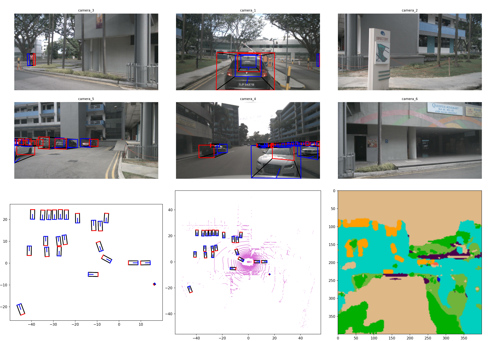
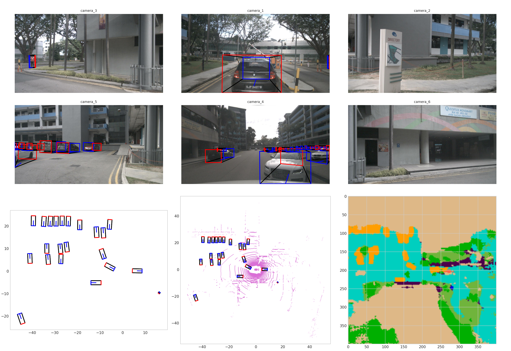

# heal-model-toolkit

A toolkit for training, fine-tuning, and exporting models with Horizon HEAL. The steps below cover FP32 inference, post-training quantization (PTQ), and HBM compilation for RDK S600 (`nash-p`).

## Installation

1. Request access to https://github.com/HorizonRobotics/Heal and clone the repository locally.

2. Configure Heal according to the instructions in `Heal/README.md`.

3. Prepare the nuScenes dataset for calibration and place it in `data/nuscenes`.

## Usage

### FP32 inference and timing

```bash
bash scripts/run_bevfusion_float.sh --warmup 2 --runs 10
# Add --visualize for a PNG preview. Add --samples PATH for a different demo frame.
```

### PTQ and S600 compilation

```bash
# Confirm that 100 complete calibration frames are available without loading the model.
bash scripts/compile_bevfusion_s600.sh --check-data --calibration-frames 100

# Calibrate and build a nash-p HBM. Choose a new or empty directory for each build.
bash scripts/compile_bevfusion_s600.sh --calibration-frames 100 \
  --format both --output outputs/bevfusion_s600_100
```

| `--format` | Model artifacts |
| --- | --- |
| `hbm` (default) | `model.hbm` |
| `both` | `model.hbm`, `qat.bc`, `quantized_infer.bc`, `quantized_deploy.bc` |
| `hbir` | `qat.bc`, `quantized_infer.bc`; no HBM compilation |

`qat.bc` is the source HBIR containing quantization parameters; its name does not imply QAT training. `quantized_infer.bc` is for host-side HBIR inference, while `quantized_deploy.bc` is the board-facing graph. 

The HBM uses six pairs of NV12 Y/UV planes by default (`--camera-input nv12`); `--camera-input ddr` instead takes a normalized YUV444 image tensor.

 See `compile_report.json` in the output directory for calibration tokens, tool versions and compile status. A successful compile is not a board execution or accuracy check.

```bash
# Single-frame smoke test; not suitable for measuring PTQ accuracy.
bash scripts/compile_bevfusion_s600.sh --samples data/samples \
  --format hbir --output outputs/bevfusion_s600_smoke

# Compile again without repeating calibration (pass qat.bc, not quantized_infer.bc).
bash scripts/compile_bevfusion_s600.sh --from-hbir outputs/bevfusion_s600_100/qat.bc \
  --output outputs/bevfusion_s600_recompile
```

## Board verification

1. Prepare the board demo as follows:

    ```bash
    bash scripts/bevfusion_board_demo.sh prepare
    ```

2. Copy `outputs/bevfusion_board_demo` to the board

3. Compile and run the demo as follow:

    ```bash
    cd bevfusion_board_demo
    
    cmake -S . -B build -DCMAKE_BUILD_TYPE=Release
    cmake --build build -j4
    
    # Warm up 5 times, then run 50 timed iterations; `board_results` must be a new directory.
    ./build/board_demo model.hbm inputs board_results 50 5
    ```

4. Copy the result to the host, then decode and visualize it as follows:

   ```bash
   bash scripts/bevfusion_board_demo.sh decode --board-output board_results
   bash scripts/bevfusion_board_demo.sh visualize
   ```

## Benchmarking


| Platform                    | mean  | P50   | P95   | min/max  |
| --------------------------- | ----- | ----- | ----- | -------- |
| host (5070TI, float)        | ~65ms | ~64ms | ~72ms | ~59/73ms |
| board (RDK S600, quantized) | ~20ms | ~20ms | ~20ms | ~19/20ms |

## Visualization

### On-Host Visualization (5070TI, Float Model)



### On-Board Visualization (RDK S600, Quantized Model)




## Troubleshooting

If importing the plugin fails with `libhorizon_ops.so: cannot enable executable stack`, inspect the library's `GNU_STACK` flags. 

```bash
LIB="$CONDA_PREFIX/lib/python3.10/site-packages/horizon_plugin_pytorch/libhorizon_ops.so"
readelf -W -l "$LIB" | grep GNU_STACK
# Only if this wheel reports RWE and fails to load:
cp -n "$LIB" "$LIB.bak"
patchelf --clear-execstack "$LIB"
readelf -W -l "$LIB" | grep GNU_STACK  # Expected: RW
python -c 'import horizon_plugin_pytorch, hbdk4.compiler; print("OK")'
```
